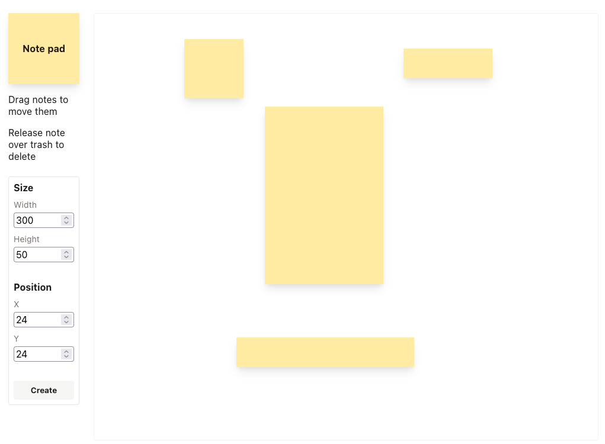
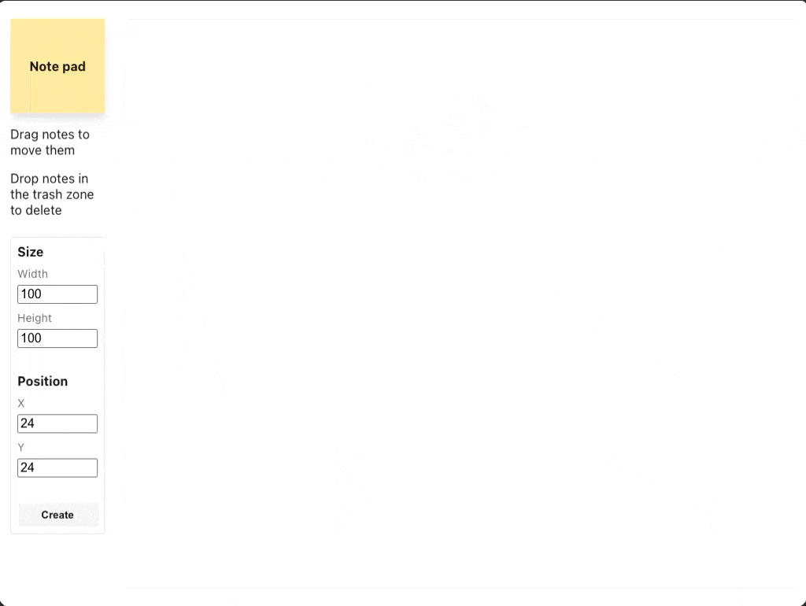
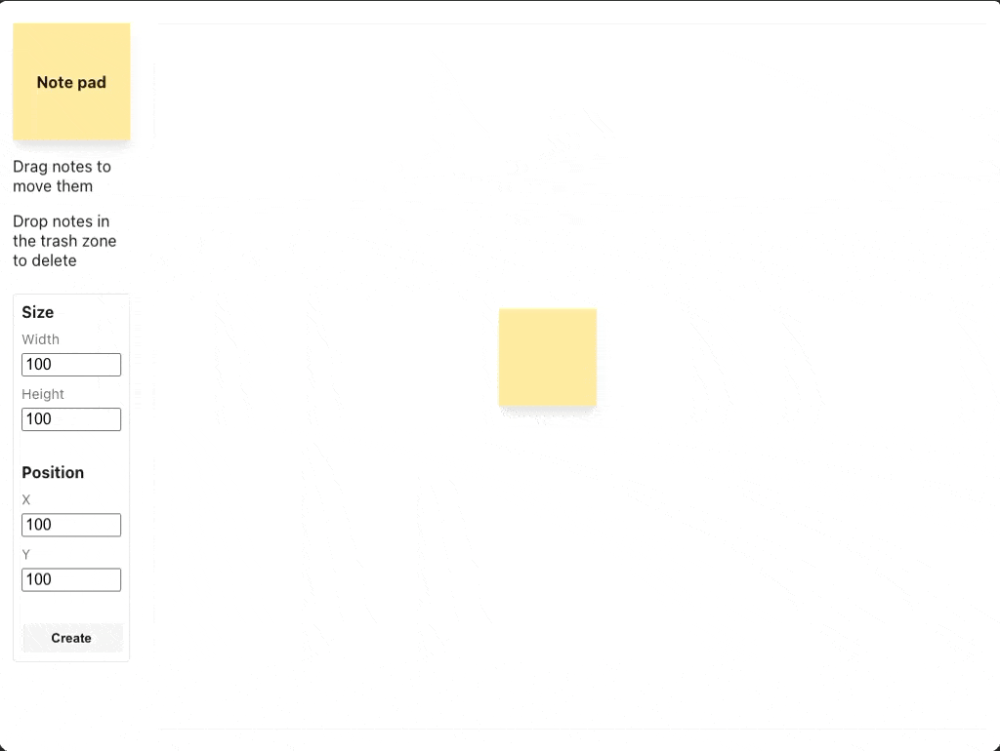
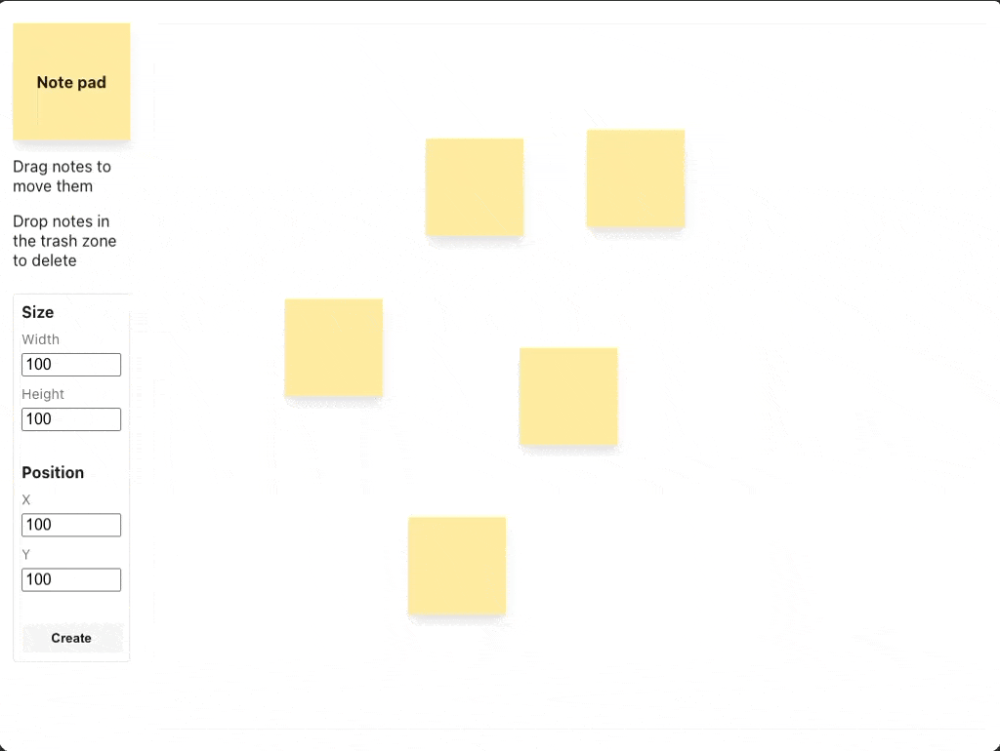

# Sticky notes


A React and TypeScript app to implement Tempo's sticky notes challenge.

This app implements three out of the four requirements:

- Create a new note of the specified size at the specified position.
- Move a note by dragging.
- Remove a note by dragging it over a predefined "trash" zone.

Resizing existing notes and the bonus features are out of scope of this submission.

## How to run

### Requirements

- Node.js 24.16 or later
- NPM

Node 24 runs the TypeScript unit tests directly without requiring additional dependencies.
First, install the dependencies with:

```
npm i
```

Then, start the application via:

```
npm run dev
```

You can run the unit tests via:

```
npm test
```

### App features


_Set the width, height, X and Y values (from the top-left of the stickies board) or use the pre-filled values, then click Create or press Enter to create a sticky note._


_Drag a note to move it. It will stay within the bounds of the board._


_To delete a note, drag until the cursor is over the trash zone, then release. The zone appears during dragging and highlights when the cursor enters it._

- Refreshing the page clears all notes.

## Approach

The code is split into components to keep it modular and separate presentation from logic where it made sense. Components are contained in their own directories alongside related files such as CSS and utility functions, with barrel files to simplify imports. StickiesBoard owns the notes state and renders each note with a stable UUID as its key. ControlPanel handles note creation along with the app's "hero" and basic instructions, while StickyNote and TrashZone render the board elements. Creating, moving and deleting notes use new arrays while preserving unchanged note objects.

The useNoteDragging hook owns the pointer event handlers and manages the drag lifecycle, allowing StickiesBoard to focus on presentation. It captures the note's original position and the pointer's starting coordinates on pointer down, then calculates the difference from those starting coordinates and keeps the note within the board while the pointer moves. On pointer up, it stops dragging and checks whether the pointer is within the trash zone to determine whether to delete the note. Pointer cancellation also stops dragging, without deleting the note.

To keep things simple and focus on the requirements, I've chosen a fixed 850px by 720px board to fit the minimum required screen resolution. Shared constants govern the rendered board size, creation limits and movement boundaries. An infinite canvas or automatically resizing board would add complexity around recalculating boundaries and keeping note positions valid. I also kept the pointer events straightforward instead of adding throttling or rendering optimisations without evidence that they were needed.

## Assumptions and trade-offs

- In a production app, we may want a design system for consistency, reusable design tokens like colors, and to speed up implementation. For example, the form controls could become reusable components. For this submission, I wanted to spend my time fulfilling the requirements and making the app usable, so I kept them local to ControlPanel.
- I use native HTML constraints on the inputs for validation to keep things simple. Custom validation could give more control over how errors are displayed, but I've left that out of scope here.
- The interface targets desktop viewports of at least 1024 by 768 pixels. Coordinates are in pixels relative to the board's top-left corner.
- Notes have integer dimensions, with a minimum width and height of 10 pixels. Each note must fit fully inside the board.
- Deletion depends on the pointer's release position. A note overlapping the trash zone is not enough, including when the note is bounded within the board but the pointer is outside it. Refining this interaction would be work for a future iteration.
- The trash zone has a higher stacking order so that it remains visible while dragging large notes, or when notes have been left over the zone without being deleted. This means it appears above the dragged note, which could also be refined in a future iteration.
- Notes can overlap, and newer notes appear above earlier ones without a way to change the stacking order.
- Notes are stored in memory and disappear on refresh.
- Movement and deletion currently require pointer input. Keyboard movement and deletion would be work for a future iteration.

## Testing

I would expect a production app to have more automated test coverage. However, setting up React component tests or automated browser tests would have taken time and attention away from the core requirements. I've opted for plain Node.js tests for the utility calculation functions, alongside manual browser testing for the requirements and edge cases.

The unit tests cover clamping values, calculating updated coordinates and checking whether a pointer is within a rectangle.

Manual testing covered creation, validation, movement, deletion, trash highlighting and cleanup in Chromium- and Firefox-based browser on macOS. Checks included large notes overlapping the trash zone with the pointer outside it, releases just outside each side of the zone, and releases outside the board. Additional checks covered the layout at 1024 by 768 and larger viewports, exact creation boundaries, a note filling the board, and clearing notes on refresh.
